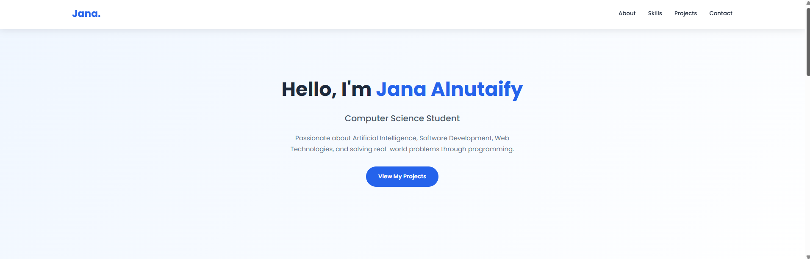
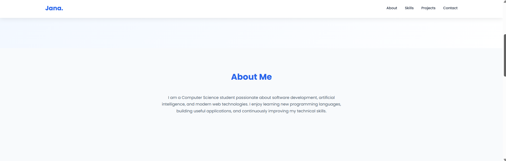
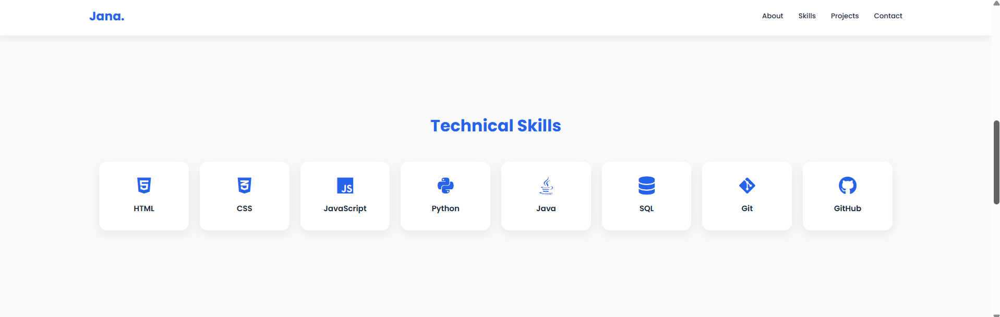
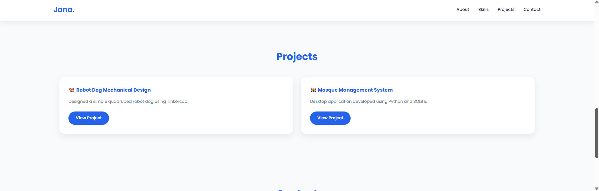
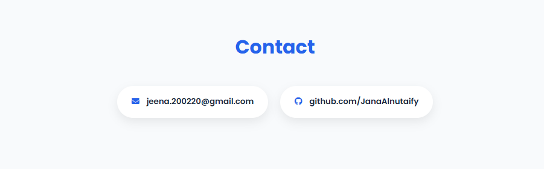

<div align="center">

# 🌐 Personal  Website


A modern, responsive, and interactive portfolio website developed using **HTML**, **CSS**, and **JavaScript** to showcase my skills, academic projects, and passion for software development.

<p>


</p>

</div>

---

# 📸 Website Preview

<p align="center">



</p>

---

# 🖼️ Gallery

<p align="center">




</p>

<p align="center">




</p>

---

# ✨ About the Project

This portfolio website was created as part of my university learning journey to present my technical skills and software development projects.

The website follows a clean and modern design while providing a responsive experience across different screen sizes. It serves as a personal portfolio where visitors can learn more about me, explore my skills, and view my featured projects.

---

# 🚀 Features

- 🎨 Modern & Clean UI
- 📱 Fully Responsive Design
- ⚡ Smooth Scrolling Navigation
- 💻 Interactive Technical Skills
- 📂 Project Showcase
- 📧 Clickable Email Link
- 🐙 GitHub Profile Link
- ✨ Hover Animations
- 🌐 Lightweight & Fast

---

# 🛠️ Technologies Used

| Technology | Purpose |
|------------|----------|
| HTML5 | Website Structure |
| CSS3 | Styling & Layout |
| JavaScript | Interactive Features |
| Font Awesome | Icons |
| Google Fonts | Typography |

---

# 📁 Project Structure

```text
Portfolio-Website/
│
├── index.html
├── style.css
├── script.js
├── README.md
├── website.peg
├── website1.peg
├── website2.peg
├── website3.peg
└── website4.peg
```

---

# 🚀 Features

- 📱 Responsive Design
- 🎨 Modern User Interface
- 💼 Project Showcase
- 💻 Technical Skills Section
- 📧 Quick Contact Access
- ⚡ Smooth Navigation.

---

# 📋 Website Sections

- 🏠 Home
- 👩 About Me
- 💻 Technical Skills
- 📂 Projects
- 📧 Contact


---

# 🎯 Future Improvements

- 🌙 Dark Mode
- 📄 Download CV
- 📝 Contact Form
- 🖼️ More Project Cards
- 🎥 Better Animations
- 🚀 Performance Enhancements

---

# ⭐ Support

If you found this project useful, consider giving it a ⭐ on GitHub.

---

<div align="center">

### Thank You for Visiting My Portfolio ❤️

Made with HTML, CSS & JavaScript

© 2026 Jana Alnutaify

</div>
